# Ant Picnic

An ant colony simulation and a neural network, both written from scratch in
C++ with no machine-learning libraries. The network learns to drive the ants,
and the project then takes it apart to see what it learned.

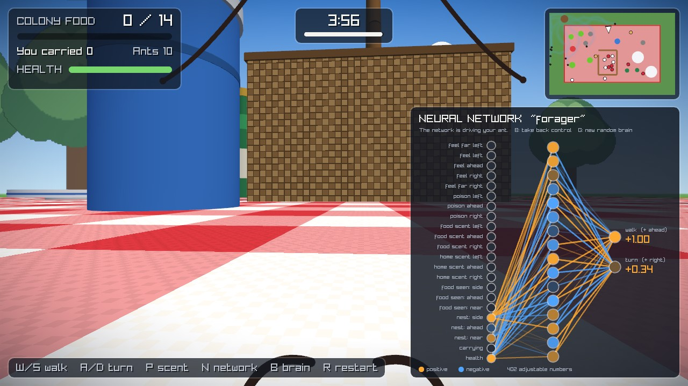

*First-person view from one ant. The panel on the right is the network that
is driving it: 22 senses in, 16 hidden neurons, 2 decisions out.*

## The simulation

Ten ants, one anthill, and a picnic left on the grass: 6 pieces of food in
the open and 8 inside a basket with a single doorway. Poison puddles drain an
ant's health. The colony has four minutes to bring everything home.

Like real ants, they are nearly blind and talk only by scent. Every ant marks
the ground as it walks, and others follow the marks. Every map is random:
the nest, basket, obstacles, poison and food are placed differently each game.

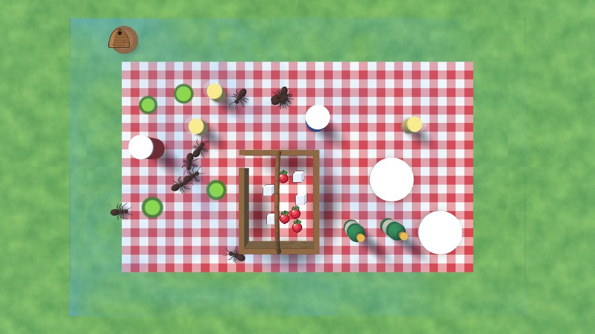

*A colony driven by the trained `forager` network, seen from above (key `O`).*

## Finding 1: a network learned to forage as well as hand-written rules

The ants first ran on a set of hand-written rules (the "instinct"). A network
with 402 adjustable numbers was then trained in two steps: imitate the
instinct, then evolve by keeping the best of each generation.

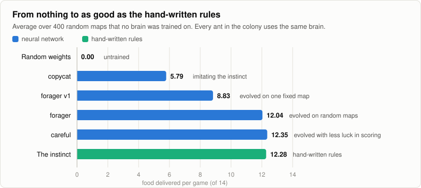

| Brain | How it was made | Food per game (of 14) | Games won (of 400) |
| --- | --- | --- | --- |
| Random weights | untrained | 0.00 | 0 |
| `copycat` | imitating the instinct | 5.79 | 30 |
| forager v1 | evolved on one fixed map | 8.83 | 98 |
| `forager` | evolved on random maps | 12.04 | 247 |
| `careful` | evolved with less luck in scoring | 12.35 | 223 |
| The instinct | hand-written rules | 12.28 | 276 |

The networks match the instinct on food carried home. The instinct still wins
more games outright.

## Finding 2: it memorised the map until the map was randomised

The first evolved brain (forager v1) scored 13.1 on its tests. Those tests
only moved the food; the basket and obstacles were always in the same place.
On maps where everything moves it scores 8.83. It had partly learned the
layout, not the task.

Randomising the whole map and continuing training brought it back up to 12.04
on maps it has never seen. The lesson is about testing as much as training:
the problem stayed hidden for as long as the test maps resembled the training
maps.

## Finding 3: nearly every lost game is lost at the basket

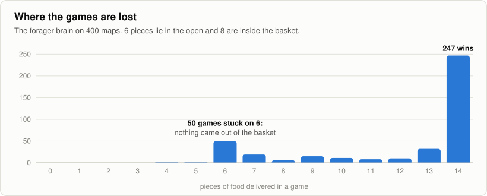

Games end in one of two ways: a win (all 14), or stuck on exactly 6. Six is
the food lying in the open. A game that ends on 6 is one where the colony
never got anything out of the basket. The hand-written instinct fails the
same way. More training of the same kind stopped helping here; the next step
would be to reward basket food directly or give the ants a sense for doorways.

## Finding 4: the network found the same rules, without being told them

The chart shows how strongly each sense pushes the ant to turn left or right
(the network's Jacobian), measured over 32,000 real moments.

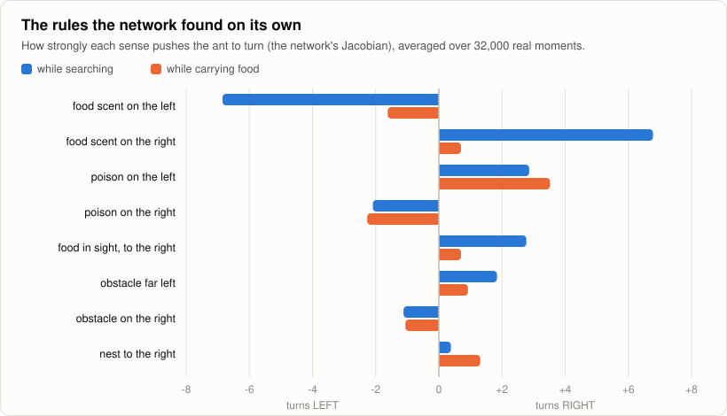

Read as rules:

- Turn toward the stronger food scent, but mostly ignore it once carrying food.
- Turn away from poison, always.
- Turn toward food in sight.
- Turn away from obstacles.
- Turn toward the nest only when carrying.

Nobody wrote these into the network. They are the rules the hand-written
instinct uses, rediscovered by training. One surprise: the "walk" output
barely reacts to anything. The network walks at full speed all the time and
does all its work by turning.

## Finding 5: some neurons have jobs you can point to

Each hidden neuron was silenced in turn, and the colony played 60 maps
without it.

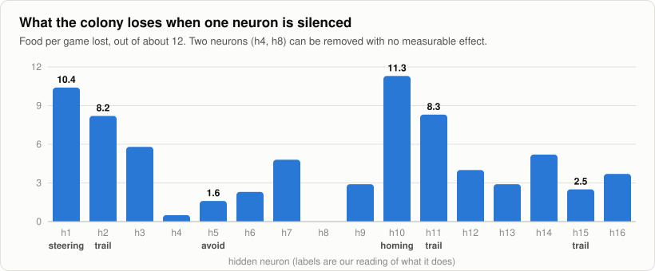

| Neuron | Food lost | What it appears to do |
| --- | --- | --- |
| h10 | 11.3 | Homing. Without it ants still pick food up but stop bringing it home. |
| h1 | 10.4 | General steering. |
| h2, h11, h15 | 8.2, 8.3, 2.5 | Following food scent trails. |
| h5 | 1.6 | Turning away from obstacles on the right. |
| h4, h8 | about 0 | Nothing measurable: the brain works as well with 14 neurons. |

No single neuron handles poison. With any one neuron removed, deaths stay at
zero, so that skill is spread across several. The "what it does" labels are
our reading of the measurements, not something the tool proves.

## Finding 6: change a few weights and you get a different ant

Seven brains made by hand-editing the `forager`, with no training. Each
screenshot is one minute into a game, all ten ants using the same brain.

| | |
| --- | --- |
| 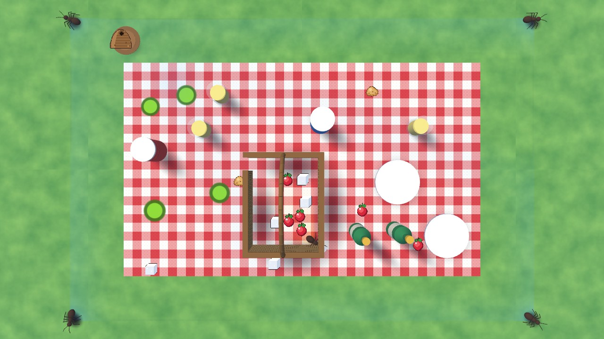 | 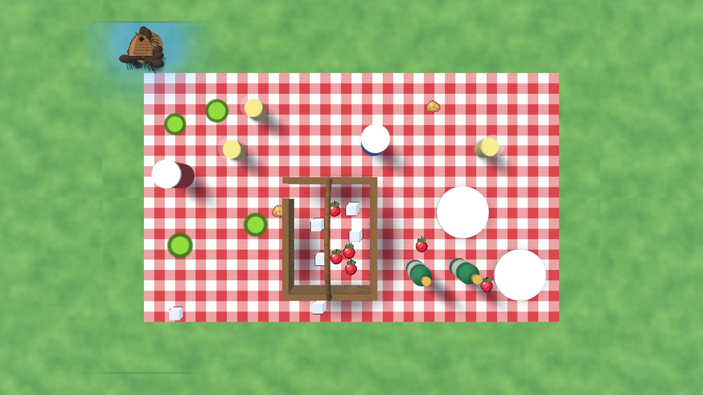 |
| **`escapist`** runs from home and pushes against the edge of the world. 94% of its time is spent at the map edge. *Homing neuron silenced, feelers cut, one added neuron that turns away from the nest.* | **`homebody`** never leaves the nest: it stays 1.9 units away on average (the forager: 19.6). *One added neuron that turns toward the nest.* |
| 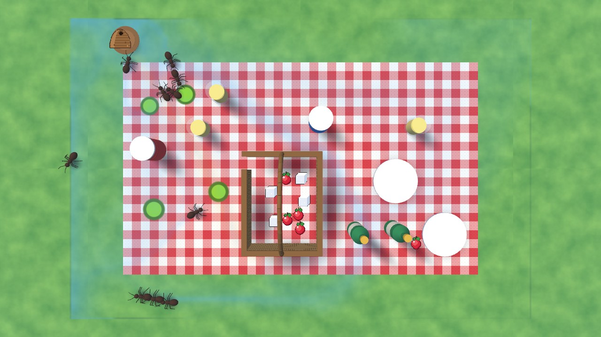 | 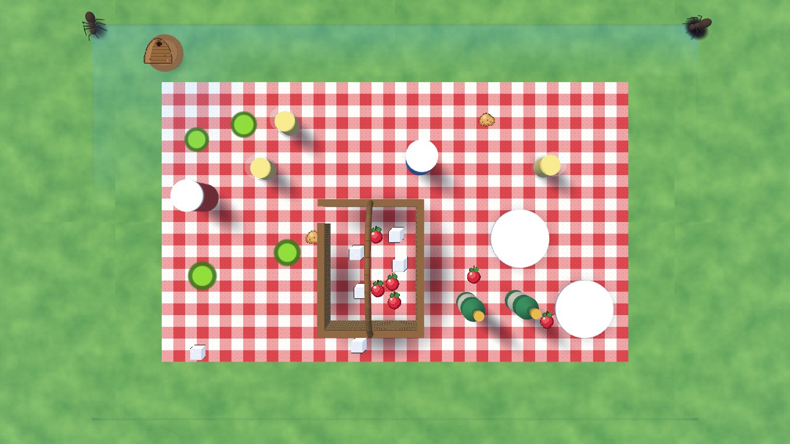 |
| **`poison-courier`** soaks in poison, then walks home poisoned: 20 poisoned trips home per game (the forager: 0.2). *Poison senses cut, four added neurons.* | **`moonwalker`** walks backwards until it hits the edge of the world. *One added neuron that pushes "walk" into reverse.* |
| 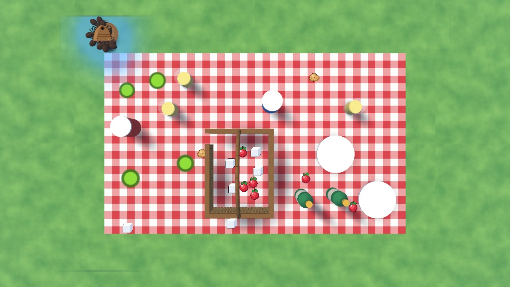 | 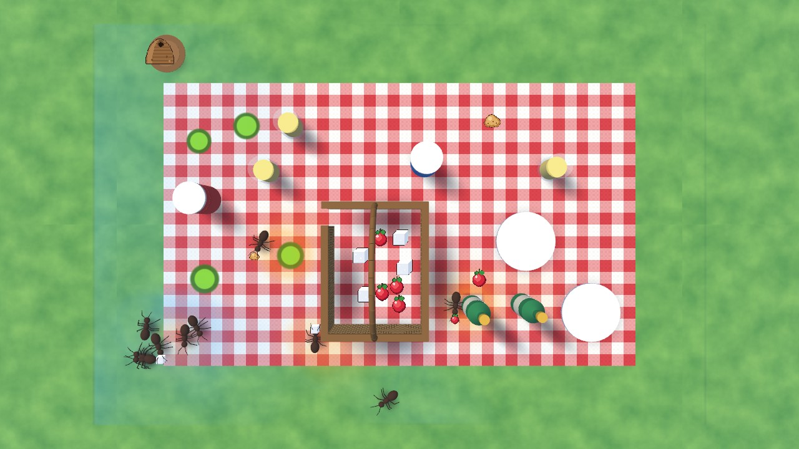 |
| **`spinner`** turns in circles at 28.6 turns per minute, the fastest an ant can spin. *One added neuron that always pushes "turn".* | **`amnesiac`** finds food and forgets the way home: 7.6 pickups per game, 0.9 delivered. *The homing neuron (h10) silenced.* |

The seventh, `poison-lover`, steers into poison and loses about one ant per
game. The exact weights changed for each are listed in
[brains/weird/README.md](brains/weird/README.md).

None of these hand edits made a better ant. Grafting a neuron that looked
helpful ("steer harder for the nest when carrying") nearly halved the food
delivered. The trained weights are balanced against each other.

## Run it

Requirements: CMake 3.24+ and a C++20 compiler (Visual Studio Build Tools on
Windows). raylib 5.5 is downloaded automatically the first time you configure.

```bash
cmake -S . -B build
```

```bash
cmake --build build --config Release
```

Play as an ant, with the other nine on instinct:

```bash
build/Release/ant_game.exe
```

Watch the trained network drive the whole colony:

```bash
build/Release/ant_game.exe --brain brains/forager.brain --colony-brain brains/forager.brain
```

Watch a weird one from above:

```bash
build/Release/ant_game.exe --overhead --brain brains/weird/escapist.brain --colony-brain brains/weird/escapist.brain
```

| Key | Action |
| --- | --- |
| `W` `S` / `Up` `Down` | Walk forward / backward |
| `A` `D` / `Left` `Right` | Turn left / right |
| `O` | Switch between the ant's view and the view from above |
| `N` | Show or hide the live network view |
| `B` | Let the network drive your ant, or take control back |
| `G` | Swap in a new random network |
| `P` | Show or hide the scent trails |
| `R` | Restart on a new random map |
| `Esc` | Quit |

| Option | Effect |
| --- | --- |
| `--autopilot` | Your ant follows the built-in instinct. |
| `--brain <file>` | A network loaded from a brain file drives your ant (`random` for an untrained one). |
| `--colony-brain <file>` | A network drives the other nine ants in place of their instinct. |
| `--overhead` | Start in the view from above. |
| `--show-network` | Start with the network view open. |
| `--seed <number>` | Start on that map. Without it, every launch picks a different random map. |
| `--record <file>` | Record your own play, for a network to learn from. |
| `--save-brain <file>` | Write the current network to a brain file. |

How to play: walk into food to pick it up, and onto the anthill's dirt patch
to deliver it. Blue scent leads home and orange leads to food. Stay out of
the green puddles.

## Train and inspect

`ant_train` does everything without a window. Run it with no arguments for
the full list of options.

| Command | What it does |
| --- | --- |
| `xor` | Proves the learning math works on the classic XOR problem. |
| `imitate` | Trains a brain to copy a teacher: the instinct, or a recording of you. |
| `evolve` | Improves a brain by selection and mutation, on new random maps every generation. |
| `score` | Plays unseen maps and reports food delivered, wins and deaths. |
| `inspect` | Silences each neuron and sense in turn, and prints the Jacobian. |
| `silence`, `graft` | Fix a neuron or sense at a value, or add a hand-made neuron. |
| `behaviour` | Measures what a colony is like: time in poison, distance from the nest, spinning. |

```bash
build/Release/ant_train.exe evolve --start brains/copycat.brain --first-seed 100 --out brains/forager.brain
```

**If Windows refuses to run `ant_train.exe` or `ant_tests.exe`** ("An
Application Control policy has blocked this file"), Smart App Control is
blocking a freshly built, unsigned program. Build and run them in WSL
instead; from the project folder inside WSL:

```bash
cmake -S . -B ~/ant-build -DANT_BUILD_GAME=OFF -DCMAKE_BUILD_TYPE=Release && cmake --build ~/ant-build -j
```

```bash
~/ant-build/ant_tests && ~/ant-build/ant_train xor
```

Brain files are plain text, so the Windows game loads brains trained in WSL.

## Documentation

- [docs/NEURAL_NETWORK.md](docs/NEURAL_NETWORK.md) - what a neural network is
  and all the math behind it, from one neuron to backpropagation.
- [docs/TRAINING.md](docs/TRAINING.md) - how the network is trained, the
  results in full, and how to look inside a brain.
- [docs/ARCHITECTURE.md](docs/ARCHITECTURE.md) - how the simulation and game
  are put together.
- [brains/weird/README.md](brains/weird/README.md) - the weird brains and
  exactly which weights were changed to make each.

The charts are drawn by `node docs/images/make-charts.js`. All measurements
come from `ant_train`; the 79 unit tests cover the simulation, the network
and the training code.
